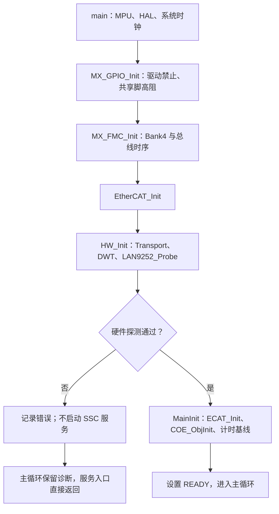
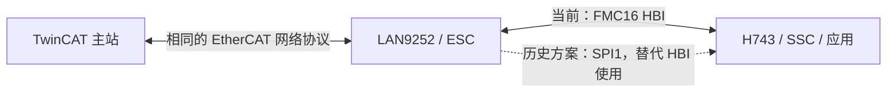

# STM32H743 + LAN9252：PDO 回环、HBI 代码导读与 TwinCAT 操作

编写日期：2026-10-26。适用硬件：本项目 H743 原理图对应板卡；适用软件：当前 FMC16 HBI 通信专用工程。本文面向需要理解代码、复现测试和继续维护工程的读者。

**当前结论：实板已通过 HBI 进入 OP，并完成最小 PDO 回环。** 这个结论依据本次聊天中的 TwinCAT、Keil 截图及操作者反馈；各项证据的范围见第 8 节。本文只说明已有实现，不增加电机指令，也不修改固件、ESI 或 EEPROM。

## 目录

1. [PDO 回环测试究竟验证什么](#pdo-purpose)
2. [关键代码位置与启动、轮询逻辑](#code-map)
3. [一次 ControlWord 交换如何经过整个工程](#pdo-path)
4. [HBI 的具体操作：地址、总线、CSR 与 PRAM](#hbi-operations)
5. [HBI 与 SPI 的区别、联系及代码对照](#spi-comparison)
6. [TwinCAT 操作与代码、芯片配置的对应关系](#twincat)
7. [本次问题复盘与诊断速查](#diagnostics)
8. [实板结果、证据边界与后续复现检查](#evidence)
9. [参考资料及推荐阅读顺序](#references)

### 阅读前先确定两个边界

第一，**EtherCAT 是电脑主站与 LAN9252 之间的网络通信；HBI/SPI 是 H743 与 LAN9252 之间的本地通信。** TwinCAT 不会通过电脑网线直接产生 MCU 的 HBI 时序。

第二，本文对照的 SPI 实现来自历史提交 `60f64449e8fa3eea2335b9b3200a759ef26bce98`，不是当前工作区同时启用的另一条通信通道。当前工程采用 HBI；不能把历史 SPI 初始化也加进来一起运行。

代码位置均以编写时的行号为准；链接使用本机绝对路径。后续修改导致行号变化时，以同时给出的函数名查找。

<a id="pdo-purpose"></a>

## 1．PDO 回环测试究竟验证什么

### 1.1 先认识这几个术语

| 名称 | 含义 | 本项目中的例子 |
|---|---|---|
| EtherCAT 主站 | 发起网络通信、配置从站并周期交换过程数据的一方 | 电脑上的 TwinCAT |
| ESC | EtherCAT Slave Controller，处理 EtherCAT 帧、寄存器和过程数据存储的从站控制器 | LAN9252 |
| PDI | Process Data Interface，应用处理器访问 ESC 的本地接口 | 当前 HBI，历史 SPI |
| SSC | Slave Stack Code，在 MCU 上运行的从站协议栈 | 本工程采用的 SSC 5.11 核心 |
| PDO | Process Data Object，按配置映射进行周期交换的过程数据 | ControlWord、StatusWord、CycleCounter |
| SDO | Service Data Object，通过 CoE 邮箱按对象索引读写参数 | 在线读取 `0x1018` 身份对象 |
| SM | SyncManager，管理邮箱或过程数据缓冲区的读写协调 | SM0/SM1 邮箱，SM2/SM3 PDO |
| FMMU | 将主站逻辑过程数据地址映射到 ESC 物理存储区域的硬件单元 | 主站配置过程映像与 SM 缓冲区的对应关系 |
| CoE | CANopen over EtherCAT，提供对象字典、SDO 等服务 | TwinCAT 的 CoE Online 页 |
| WKC / WcState | WKC 是 EtherCAT 数据报的工作计数；WcState 表示主站对过程数据工作计数的有效性判断 | 本次要求 WcState=0，不是要求帧中的 WKC 为 0 |

RxPDO、TxPDO 按**从站方向**命名，TwinCAT 的 Inputs/Outputs 通常按**主站方向**命名：

| TwinCAT 视角 | 从站视角 | 本项目数据 |
|---|---|---|
| Outputs：电脑发出去 | RxPDO：从站接收 | 2 字节 ControlWord |
| Inputs：电脑读回来 | TxPDO：从站发送 | 2 字节 StatusWord + 4 字节 CycleCounter |

因此，`APPL_OutputMapping()` 是 MCU 接收主站输出，`APPL_InputMapping()` 是 MCU 准备主站输入。这两个名字不能按“MCU 向外输出／从外输入”反过来理解。

### 1.2 回环测试的完整路径

下图表示数据方向和功能分层，具体函数调用见第 3 节。


这不是让 LAN9252 自己把数据原样转回去。主站发出的值必须经过 HBI 到达 H743，H743 执行应用计算，再经 HBI 写回 LAN9252，主站才能读到期望结果。

### 1.3 当前回环的实际计算

位置：[ethercat_app_core.c:29](D:/STM32MX/EtherCAT-HBI/Core/Src/ethercat/ethercat_app_core.c:29)，`EtherCAT_AppCycle()`。以下为当前源码：

```c
void EtherCAT_AppCycle(void)
{
    tx_pdo.status_word = rx_pdo.control_word & UINT16_C(1);
    tx_pdo.cycle_counter++;
}
```

`& 1` 只保留最低位，所以期望关系为：

| 写入 ControlWord | 二进制最低两位 | 期望 StatusWord | 解释 |
|---:|---|---:|---|
| `0x0000` | `00` | `0x0000` | bit0 为 0 |
| `0x0001` | `01` | `0x0001` | bit0 为 1 |
| `0x0002` | `10` | `0x0000` | bit1 不参与回传 |
| `0x0003` | `11` | `0x0001` | 只回传 bit0 |

本次截图中的 `ControlWord=3`、`StatusWord=1` 正好符合该规则。字段名称虽叫 ControlWord/StatusWord，这个实验应用并没有实现 CiA402 驱动状态机；这些值也没有接到电机启动接口。

### 1.4 为什么还要有 CycleCounter

只看 StatusWord，主站可能一直显示一个旧值，例如之前读到的 1。CycleCounter 持续变化，可以进一步观察 MCU 应用是否还在产生新数据。

它由 `EtherCAT_AppCycle()` 中的自增语句更新，单位是**满足交换条件的 FreeRun 应用迭代**。主站每次采样可能看到它跳过多个值；不能把计数差直接当成 EtherCAT 帧数，也不能用它反推出 1 ms 或 10 ms 总线周期。

这里还存在三个正常现象：

- 新的主站输出到达时才更新接收影子，但同一接收值可供多次应用迭代使用。
- 离开有效交换、进入停止处理或驱动故障路径时，应用会清零自己的数据影子和计数。
- `uint32_t` 计数器正常溢出后从零继续；主站断线时也可能冻结旧输入，因此要结合状态和 WcState 判断。

### 1.5 每一项测试分别证明什么

| 现象 | 能证明的内容 | 还不能单独证明的内容 |
|---|---|---|
| TwinCAT 能扫描到从站 | 网络侧能发现 LAN9252，并获得设备身份 | H743 正在运行、HBI 能读写 |
| BYTE_TEST 为 `0x87654321` | MCU 能通过本地总线正确读取该系统寄存器 | CSR、PRAM、邮箱、周期 PDO 的完整链路 |
| 初始化状态为 1 | 当前初始化路径完成了驱动探测和 SSC 初始化 | 运行时已经 OP，或后续没有通信故障 |
| 从站 Current State 为 OP | 从站完成了到 Operational 的状态转换 | 当前应用按预期处理了每一个业务值 |
| WcState 为 0，回环值符合规则 | 当前过程数据有效，且接收、计算、返回链路按测试要求工作 | 任意长度数据、所有边界值和所有负载均通过 |
| 持续运行无错误 | 覆盖了该段时间、该配置下的运行观察 | 电机闭环、DC 同步、吞吐量和最坏时延达标 |

PDO 回环是接入电机业务前的通信基线。它让“通信问题”与“电流／速度／位置控制问题”能够分别定位，但不替代后者的验收。

<a id="code-map"></a>

## 2．关键代码位置与启动、轮询逻辑

### 2.1 代码分层索引

下面的“上游／下游”表示主要依赖方向，并不表示一行只会被一个函数调用。

| 层次与位置 | 关键入口 | 职责 | 上游 → 下游 |
|---|---|---|---|
| [main.h:63](D:/STM32MX/EtherCAT-HBI/Core/Inc/main.h:63) | `ETHERCAT_BRINGUP_ONLY` | 默认 1，选择通信专用启动路径 | 编译配置 → main/GPIO 条件分支 |
| [main.c:119](D:/STM32MX/EtherCAT-HBI/Core/Src/main.c:119) | `main()` | 公共启动、GPIO、FMC、EtherCAT 初始化和持续服务 | MCU 启动 → 各初始化函数、服务层 |
| [main.c:409](D:/STM32MX/EtherCAT-HBI/Core/Src/main.c:409) | `MPU_Config()` 的 HBI 区域 | 为 FMC 窗口设置 Device 内存属性 | main → MPU/HAL |
| [gpio.c:41](D:/STM32MX/EtherCAT-HBI/Core/Src/gpio.c:41) | `MX_GPIO_Init()` | 驱动禁止、ALEHI 固定电平、共享脚高阻 | main → GPIO |
| [fmc.c:7](D:/STM32MX/EtherCAT-HBI/Core/Src/fmc.c:7) | `HbiFmcConfigure()` | Bank4、16 位复用总线和时序 | `MX_FMC_Init()` → HAL/FMC |
| [fmc.c:42](D:/STM32MX/EtherCAT-HBI/Core/Src/fmc.c:42) | `HAL_SRAM_MspInit()` | 配置 FMC 时钟和 AD/CS/RD/WR/ALELO 引脚 | HAL SRAM 初始化 → GPIO AF12 |
| [lan9252_board.c:55](D:/STM32MX/EtherCAT-HBI/Core/Src/ethercat/lan9252_board.c:55) | `LAN9252_BoardTransport()` | 提供硬件回调，初始化并自检 DWT | 硬件端口 → 半字 MMIO／微秒时基 |
| [lan9252_board.c:29](D:/STM32MX/EtherCAT-HBI/Core/Src/ethercat/lan9252_board.c:29) | `board_read16()` / `board_write16()` | 真正触发 FMC 的物理半字访问 | HBI `direct()` → FMC 外部窗口 |
| [lan9252_hbi.c:51](D:/STM32MX/EtherCAT-HBI/Core/Src/ethercat/lan9252_hbi.c:51) | `direct()` | 两次半字组成一次系统 DWORD 访问 | CSR/PRAM/探测 → 板级回调 |
| [lan9252_hbi.c:140](D:/STM32MX/EtherCAT-HBI/Core/Src/ethercat/lan9252_hbi.c:140) | `csr()` | 间接读写 ESC 控制寄存器 | `LAN9252_Read/WriteEsc()` → `direct()` |
| [lan9252_hbi.c:171](D:/STM32MX/EtherCAT-HBI/Core/Src/ethercat/lan9252_hbi.c:171) | `pram()` | 通过 FIFO 读写 ESC 过程 RAM | 同上 → `direct()` |
| [lan9252_hbi.c:228](D:/STM32MX/EtherCAT-HBI/Core/Src/ethercat/lan9252_hbi.c:228) | `probe()` | BYTE_TEST、READY、ID、PDI、EEPROM 等探测 | `HW_Init()` → 系统寄存器和 CSR |
| [lan9252_port.c:23](D:/STM32MX/EtherCAT-HBI/Core/Src/ethercat/lan9252_port.c:23) | `HW_Init()`、`HW_EscRead/Write()` | 向 SSC 提供硬件接口，锁存首错 | SSC／服务层 → LAN9252 驱动 |
| [lan9252_port.c:77](D:/STM32MX/EtherCAT-HBI/Core/Src/ethercat/lan9252_port.c:77) | 邮箱缓冲分配／释放 | 管理 24 个 128 字节固定缓冲块 | 邮箱处理 → 静态 RAM 池 |
| [ethercat_service.c:43](D:/STM32MX/EtherCAT-HBI/Core/Src/ethercat/ethercat_service.c:43) | `EtherCAT_Init()` | 组织驱动探测和 SSC 初始化 | main → HW_Init/MainInit |
| [ethercat_service.c:99](D:/STM32MX/EtherCAT-HBI/Core/Src/ethercat/ethercat_service.c:99) | `EtherCAT_Service()` | 持续运行协议栈、更新诊断、故障停止 | main 循环 → SSC MainLoop |
| [ecatappl.c:494](D:/STM32MX/EtherCAT-HBI/Middlewares/Third_Party/EtherCAT_SSC/Src/ecatappl.c:494) | `MainInit()` | 初始化 ESC 状态机、对象字典和计时基线 | 服务层 → ECAT_Init/COE_ObjInit |
| [ecatappl.c:532](D:/STM32MX/EtherCAT-HBI/Middlewares/Third_Party/EtherCAT_SSC/Src/ecatappl.c:532) | `MainLoop()` | FreeRun 下处理 PDO、应用、定时和协议服务 | 服务层 → 应用／ECAT_Main／CoE |
| [ecatslv.c:2431](D:/STM32MX/EtherCAT-HBI/Middlewares/Third_Party/EtherCAT_SSC/Src/ecatslv.c:2431) | `ECAT_Main()` | AL 状态请求、SM 变化、邮箱事件 | SSC MainLoop → 状态转换／邮箱 |
| [mailbox.c:747](D:/STM32MX/EtherCAT-HBI/Middlewares/Third_Party/EtherCAT_SSC/Src/mailbox.c:747) | `MBX_CheckAndCopyMailbox()` | 从 SM0 收取邮箱内容并进入协议分发 | ECAT_Main → 邮箱／CoE |
| [ecatcoe.c:98](D:/STM32MX/EtherCAT-HBI/Middlewares/Third_Party/EtherCAT_SSC/Src/ecatcoe.c:98) | `COE_ServiceInd()` | 区分 SDO 请求与对象信息请求 | 邮箱分发 → SDO 服务 |
| [sdoserv.c:609](D:/STM32MX/EtherCAT-HBI/Middlewares/Third_Party/EtherCAT_SSC/Src/sdoserv.c:609) | `SDOS_SdoInd()` | 解析索引、子索引、长度和读写请求 | CoE → 对象访问 |
| [objdef.c:800](D:/STM32MX/EtherCAT-HBI/Middlewares/Third_Party/EtherCAT_SSC/Src/objdef.c:800) | `OBJ_Read()` / `OBJ_Write()` | 按对象字典定义读写条目并检查访问条件 | SDO 服务 → 对象存储 |
| [ethercat_app.c:42](D:/STM32MX/EtherCAT-HBI/Core/Src/ethercat/ethercat_app.c:42) | `ApplicationObjDic[]`、`APPL_*()` | 对象字典、PDO 映射、应用生命周期 | SSC → 应用核心 |
| [ethercat_app_core.c:6](D:/STM32MX/EtherCAT-HBI/Core/Src/ethercat/ethercat_app_core.c:6) | `EtherCAT_App*()` | 字节拆装、最低位回环、计数和清零 | APPL 回调 → RAM 中的过程数据影子 |
| [ethercat_identity.h:7](D:/STM32MX/EtherCAT-HBI/Core/Inc/ethercat/ethercat_identity.h:7) | 身份宏 | 名称、Vendor、Product、Revision、Serial | 对象字典／配置一致性检查 |

协议栈的源码不是本项目从零编写的 EtherCAT 协议实现。其来源与本地适配说明位于 [SSC README](D:/STM32MX/EtherCAT-HBI/Middlewares/Third_Party/EtherCAT_SSC/README.md)；本文着重说明它与本工程硬件和应用的连接处。

### 2.2 上电后先做什么

以下语句来自 `main()` 的通信路径，省略了电机分支和不相关注释：

```c
MPU_Config();
HAL_Init();
SystemClock_Config();

/* ETHERCAT_BRINGUP_ONLY == 1 */
MX_GPIO_Init();
MX_FMC_Init();
ethercat_init_status = EtherCAT_Init();
ethercat_diagnostics = EtherCAT_GetDiagnostics();
```



探测顺序按 [probe()](D:/STM32MX/EtherCAT-HBI/Core/Src/ethercat/lan9252_hbi.c:228) 为：

1. 限时读取 BYTE_TEST，直到 `0x87654321`；这个阶段尚不向 LAN9252 写寄存器。
2. 检查 `HW_CFG` 的 READY 位。
3. 检查 `ID_REV` 高 16 位为 `0x9252`。
4. 经 CSR 读取 ESC `0x0140`，确认 PDI 为 `0x89`。
5. 读取 EEPROM 状态，检查 `0xF800` 掩码下没有错误／未就绪位。
6. 读取 ESC 信息和 AL 状态，随后才进行 SSC 初始化。

这里“BYTE_TEST 前不写”的含义是先确认本地访问基本有效。成功后，读取 ESC 内部地址本身需要写 CSR 命令寄存器，不属于“驱动始终只读”。该探测也不会替操作者写入 EEPROM 或把 SPI 自动切成 HBI。

`ethercat_init_status=1` 对应 READY；`2` 表示 LAN9252 初始化错误；`3` 表示 SSC 初始化错误。这个全局变量保存 `EtherCAT_Init()` 的返回值，不是实时 AL 状态。

### 2.3 主循环为何必须一直运行

当前通信分支的主循环持续调用 `EtherCAT_Service()`，没有加入人为的毫秒延时。其核心行为是：

```text
EtherCAT_Service
  ├─ 若服务内部状态不是 READY：直接返回
  ├─ 检查硬件端口是否锁存故障
  ├─ MainLoop
  │   ├─ FreeRun 轮询 AL Event，必要时读取新的输出 PDO
  │   ├─ ECAT_Application → APPL_Application
  │   ├─ 输入更新运行时，PDO_InputMapping 写入输入 PDO
  │   ├─ 补处理经过的 1 ms 定时节拍，每次最多 8 个
  │   ├─ ECAT_Main：状态机和邮箱
  │   ├─ COE_Main
  │   └─ CheckIfEcatError
  ├─ 到 100 ms 诊断刷新间隔时，读取 AL／错误计数／过程数据影子
  └─ 更新单次服务耗时的历史最大值
```

这是按 [MainLoop()](D:/STM32MX/EtherCAT-HBI/Middlewares/Third_Party/EtherCAT_SSC/Src/ecatappl.c:532) 和服务源码整理的调用顺序；没有画成中断触发。`HW_EscReadIsr` 等名称在本工程兼容头中映射到普通端口函数，不能凭名字判断当前实际启用了 ISR。

配置见 [ecat_def.h:164](D:/STM32MX/EtherCAT-HBI/Middlewares/Third_Party/EtherCAT_SSC/Inc/ecat_def.h:164)：`AL_EVENT_ENABLED=0`、`DC_SUPPORTED=0`、`ECAT_TIMER_INT=0`、`INTERRUPTS_SUPPORTED=0`。CoE 支持开启。

MCU 暂停会停止这条调用链。LAN9252 可能仍能响应网络侧寄存器读取，但 H743 不再处理 AL 状态请求和应用数据，所以“TwinCAT 能读到芯片”与“MCU 协议栈正在服务”是两件事。

### 2.4 故障与启动隔离

硬件端口的 `RecordStatus()` 只锁存第一个非零错误。服务层发现故障时执行 `StopOnFault()`，清理应用影子并停止后续协议栈工作；不会每轮自动清错重试。主循环依然存在，因此可以观察诊断。

当前通信模式不会调用电机分支中的 ADC、SPI2/3/4、TIM、UART、USB 设备服务和 `MotorControl_Start()`。`ETHERCAT_BRINGUP_ONLY=0` 是原电机路径，不是“把 HBI 换回 SPI”的开关。

PF6 LED 的初始化仅存在于当前 `gpio.c` 的电机分支。通信分支未配置 PF6，主循环也没有点灯或闪烁逻辑。按原理图 LED 是低电平点亮，因此**本次通信固件 LED 不亮不能作为 HBI 失败或 3.3 V 缺失的证据**。此前讨论的补充点灯代码尚不在当前实现中；本文不修改它。

### 2.5 邮箱／SDO 与 PDO 怎样共存

PDO 传的是已经约定好布局的周期数据；SDO 则把“读哪个索引、哪个子索引、多少字节”的请求通过邮箱送入从站。二者使用不同的 SM 通道，但在 MCU 侧都经过 `HW_EscRead/Write()` 和 PRAM 访问。

一次普通 SDO 请求的主要调用链可概括为：

```text
TwinCAT CoE Online 的实际设备读取
→ EtherCAT 写入 SM0 邮箱
→ ECAT_Main 检查邮箱事件
→ MBX_CheckAndCopyMailbox / 邮箱协议分发
→ COE_ServiceInd
→ SDOS_SdoInd
→ OBJ_Read 或 OBJ_Write
→ 邮箱响应发送路径写入 SM1
→ 主站读回响应
```

这张图省略了队列、重复请求和分包信息处理分支，不能作为绕过 SSC 自行拼装邮箱的实现模板。`COE_ObjInit()` 在初始化时注册对象；`COE_Main()` 处理 CoE 后续服务，并不意味着每个对象请求都仅在这个函数中首次解析。

本项目支持普通单条目 SDO／SDOInfo，未启用分段 SDO、Complete Access 等所有可选功能；看到“支持 CoE”不能理解成支持 CoE 的每一种服务。具体开关和适配边界见 SSC README。

<a id="pdo-path"></a>

## 3．一次 ControlWord 交换如何经过整个工程

### 3.1 从对象字典找到 SM 和实际字节

映射定义见 [ethercat_app.c:7](D:/STM32MX/EtherCAT-HBI/Core/Src/ethercat/ethercat_app.c:7)，主站描述见 [HBI ESI:117](D:/STM32MX/EtherCAT-HBI/EtherCAT/H743-LAN9252-HBI-LAB.xml:117)。

| 用途 | 分配／映射对象 | 数据对象 | ESC 缓冲区 | 字节数 |
|---|---|---|---|---:|
| 主站到从站邮箱 | SM0，MBoxOut | CoE 请求等 | `0x1000` | 128 |
| 从站到主站邮箱 | SM1，MBoxIn | CoE 响应等 | `0x1080` | 128 |
| RxPDO，主站输出 | `0x1C12 → 0x1600` | `0x7000:01` ControlWord | SM2，`0x1100` | 2 |
| TxPDO，主站输入 | `0x1C13 → 0x1A00` | `0x6000:01` StatusWord；`0x6000:02` CycleCounter | SM3，`0x1400` | 6 |

`0x70000110` 这样的映射值可分解为：对象索引 `0x7000`、子索引 `01`、长度 `0x10=16 bit`。`0x60000220` 则表示 `0x6000:02`、32 bit。它们不是 FMC 地址。

应用通过 `APPL_GenerateMapping()` 报告输入 6 字节、输出 2 字节；ESI 中相同的大小和固定映射用于主站配置。SSC 会维护运行时的 `nEscAddrOutputData` 和 `nEscAddrInputData`，底层 PDO 函数使用这两个变量；本工程 ESI 的默认 SM 起始地址如上表，并非 PDO 函数直接硬编码地址。

截图中变量列表的 `>Addr...` 列显示的是主站过程映像中的地址／偏移，例如本次 ControlWord 曾显示为 `39.0`，不能把它当成 ESC 的 `0x1100` 或 FMC 地址。主站过程映像由 FMMU 等配置映射到 ESC 缓冲；SM 则负责两侧对这些缓冲区的访问协调。

### 3.2 主站把输出写到 LAN9252，MCU 再读取

以 TwinCAT 写入 `ControlWord=3` 为例：

1. TwinCAT 将周期输出字节 `03 00` 放入 EtherCAT 过程数据。
2. LAN9252 将对应数据交给已配置的 SM2 缓冲机制。
3. SSC `MainLoop()` 轮询 AL Event。出现 `PROCESS_OUTPUT_EVENT` 时标记首次输出已接收；输出更新已启动时调用 `PDO_OutputMapping()`。
4. `PDO_OutputMapping()` 先从 ESC 读取数据，再把 RAM 缓冲交给应用。

源于 [ecatappl.c:192](D:/STM32MX/EtherCAT-HBI/Middlewares/Third_Party/EtherCAT_SSC/Src/ecatappl.c:192) 的两个关键调用：

```c
HW_EscReadIsr(((MEM_ADDR *)aPdOutputData), nEscAddrOutputData, nPdOutputSize );

APPL_OutputMapping((UINT16*) aPdOutputData);
```

本工程 `HW_EscReadIsr` 是 `HW_EscRead` 的别名。地址处于 `0x1000～0x1FFF` 时，端口进入 LAN9252 PRAM 路径，并最终通过 HBI FIFO 得到字节。它不是 CPU 直接读取 `0x6C001100`。

应用的 [APPL_OutputMapping()](D:/STM32MX/EtherCAT-HBI/Core/Src/ethercat/ethercat_app.c:92) 检查交换条件，通过 `EtherCAT_AppConsumeRx()` 按 little-endian 解析控制字，更新对象影子并设置 `valid_output=TRUE`。

### 3.3 应用只在有效交换条件下计算

判断函数位于 [ethercat_app.c:61](D:/STM32MX/EtherCAT-HBI/Core/Src/ethercat/ethercat_app.c:61)，当前源码如下：

```c
static BOOL ExchangeActive(void)
{
    return bEcatInputUpdateRunning && bEcatOutputUpdateRunning &&
           bEcatFirstOutputsReceived && !HW_AccessFault();
}
```

`APPL_Application()` 还要求 `valid_output` 为真。上述标志由 SSC 的状态机和过程数据处理维护；应用并非看到 TwinCAT 界面显示一个数值就开始计数。

随后 `ECAT_Application()` 调用 `APPL_Application()`，后者执行 `EtherCAT_AppCycle()`，把最低位状态和计数复制到对象字典的输入影子。

`ResetProcessData()` 会清除 `valid_output`、控制字、状态字和计数。邮箱／输入／输出启停回调以及应用错误确认路径均可调用它。这样重新进入有效交换时，不会继续使用上一会话留下的控制字。

`0x7000:01` 允许 SDO 写入，且 SDO 与 PDO 共用对象影子；但是 **SDO 写入不能替代首次有效 PDO 接收和输出更新条件**。因此回环测试必须写 TwinCAT 周期输出变量，不能只用 CoE Online 的 SDO 下载代替。

### 3.4 应用把输入写回 LAN9252

输入路径的顺序与输出路径相反。位置：[ecatappl.c:181](D:/STM32MX/EtherCAT-HBI/Middlewares/Third_Party/EtherCAT_SSC/Src/ecatappl.c:181)。

```c
APPL_InputMapping((UINT16*)aPdInputData);
HW_EscWriteIsr(((MEM_ADDR *) aPdInputData), nEscAddrInputData, nPdInputSize );
```

`APPL_InputMapping()` 将应用数据编码到 MCU 的 RAM 缓冲；`HW_EscWrite()` 通过 PRAM 写入 SM3 对应的过程 RAM。主站后续周期读取这些输入。网络帧交换与 MCU FreeRun 迭代并非一一锁步，不能由本图推出固定的一周期响应延迟。

### 3.5 字节序、长度和结构体对齐

源于 [ethercat_app_core.c:13](D:/STM32MX/EtherCAT-HBI/Core/Src/ethercat/ethercat_app_core.c:13) 的接收函数：

```c
void EtherCAT_AppConsumeRx(const uint8_t rx[2])
{
    rx_pdo.control_word = (uint16_t)((uint16_t)rx[0] | ((uint16_t)rx[1] << 8));
}
```

输入的 6 个线上字节由 `EtherCAT_AppProduceTx()` 显式填充：

| 字节偏移 | 内容 |
|---:|---|
| 0 | StatusWord 的 bit7～bit0 |
| 1 | StatusWord 的 bit15～bit8 |
| 2 | CycleCounter 的 bit7～bit0 |
| 3 | CycleCounter 的 bit15～bit8 |
| 4 | CycleCounter 的 bit23～bit16 |
| 5 | CycleCounter 的 bit31～bit24 |

例如，假设控制字为 3、某次计数为 `0x12345678`，则回传示例为：

```text
主站输出：03 00
主站输入：01 00 78 56 34 12
```

该计数只是说明字节序的示例，不是本次截图里的计数。

`EtherCATTxPdo` 的 C 成员是 `uint16_t` 和 `uint32_t`，编译器可能在它们之间放入对齐空隙；对象字典的记录结构还包含子索引计数。**C 内存对象布局、对象字典布局和线上 PDO 布局不能视为同一个结构。** 本工程显式拆装 2／6 个字节，避免把填充字节发送出去。

<a id="hbi-operations"></a>

## 4．HBI 的具体操作：地址、总线、CSR 与 PRAM

### 4.1 先区分三种地址

| 地址空间 | 示例 | 谁使用 | 怎样访问 |
|---|---|---|---|
| STM32 CPU 地址空间 | `0x6C000064` | H743 的 load/store 指令 | FMC Bank4 基址加主机接口偏移 |
| LAN9252 主机接口寄存器偏移 | BYTE_TEST `0x0064`；CSR_CMD `0x0304`；PRAM FIFO `0x0004/0x0020` | HBI／SPI 物理驱动 | 当前经半字访问，历史经 SPI 命令 |
| ESC 内部地址空间 | AL 状态 `0x0130`；PDI `0x0140`；SM2 过程数据 `0x1100` | SSC、TwinCAT ESC Memory | MCU 侧经 CSR 或 PRAM 间接访问；主站经 EtherCAT 访问 |

同样的数值在不同地址空间中意义不同。例如：

- **主机接口偏移** `0x0304` 是 CSR 命令寄存器；**ESC 地址** `0x0304` 属于另一片内部寄存器空间，不能混为一谈。
- TwinCAT Memory 的 `Start Offset=0140` 是 ESC PDI 寄存器；不能简单令 MCU 读取 `0x6C000140` 来代替 CSR 操作。
- 对象索引 `0x7000` 和 `0x6000` 是对象字典标识，也不是上述三者中的物理缓冲地址。

[lan9252_regs.h](D:/STM32MX/EtherCAT-HBI/Core/Inc/ethercat/lan9252_regs.h) 用 `LAN9252_REG_*` 和 `LAN9252_ESC_*` 名称区分前两类芯片地址，但最终仍需看调用的是 Direct 还是 Esc 接口。

### 4.2 16 位、单阶段、地址／数据复用分别是什么意思

“16 位”表示一次外部数据传输使用 AD0～AD15。“地址／数据复用”表示同一组线在地址阶段承载地址，在数据阶段承载数据。“单阶段”表示地址只需要一个锁存阶段，不再用 ALEHI 进行第二段地址锁存。

以下是已在本板使用的连接和职责，具体电气时序应按 LAN9252 手册第 9 章及 H743 FMC 定义核对；这里的阶段描述是教学示意，不是示波器实测波形。

| LAN9252 信号 | H743 引脚 | 当前职责 |
|---|---|---|
| AD0～AD3 | PD14、PD15、PD0、PD1，依次对应 | 地址期输出地址，数据期双向传输 D0～D3 |
| AD4～AD12 | PE7～PE15，依次对应 | 同上，D4～D12 |
| AD13～AD15 | PD8、PD9、PD10，依次对应 | 同上，D13～D15 |
| CS | PG12 / NE4 | 低有效片选，限定本次总线访问 |
| RD | PD4 / NOE | 低有效读控制 |
| WR | PD5 / NWE | 低有效写控制 |
| ALELO | PB7 / NL/NADV | 地址锁存控制，当前为低有效 ALE 配置 |
| ALEHI | PF1 | 固定高，不产生第二个地址锁存阶段 |

在地址期，FMC 将地址送到 AD 线上并控制 ALELO；锁存结束后 AD 线进入数据用途。读周期由 LAN9252 驱动读数据，写周期由 H743 驱动写数据。代码不需要逐个 `HAL_GPIO_WritePin()` 模拟这些边沿；**FMC 根据地址访问自动产生它们**。

### 4.3 FMC 初始化为什么使用 HAL_SRAM_Init

位置：[fmc.c:7](D:/STM32MX/EtherCAT-HBI/Core/Src/fmc.c:7)，`HbiFmcConfigure()`。当前关键配置为：

| 项目 | 当前值 | 对本项目的作用 |
|---|---|---|
| Bank | Bank4，CPU 基址 `0x6C000000` | 访问对应 NE4 窗口 |
| DataAddressMux | ENABLE | 产生复用地址／数据总线访问 |
| MemoryType | NOR | 选择需要的 FMC 总线控制形式 |
| MemoryDataWidth | 16 bit | 对应 AD0～AD15 |
| 内核时钟 | D1HCLK，当前配置 240 MHz | 作为 FMC 时序的时钟来源 |
| AccessMode | A | 异步访问模式 |
| ADDSET / ADDHLD | 15 / 15 | 当前地址阶段参数 |
| DATAST / BUSTURN | 63 / 15 | 当前数据阶段／总线周转参数 |
| Burst / WAIT / Write FIFO | 关闭 | 当前采用保守异步访问方式 |

`MemoryType=NOR` 不表示板上接的是 NOR Flash。LAN9252 是寄存器设备；本工程通过 `HAL_SRAM_Init()` 配置 NORSRAM 控制器，**不会发 NOR Flash 识别或自动探测命令**。

`MX_FMC_Init()` 调用自定义配置后提前返回，避免 CubeMX 后续生成路径意外进行 Flash 探测。CubeMX 重生成后必须检查这个保护仍存在。

这些 FMC 时序参数和 240 MHz 是局部总线配置，不能当作 EtherCAT 的主站周期。本文不据此计算未经实测的吞吐量。

### 4.4 一条 C 语句怎样真正读到 LAN9252

位置：[lan9252_board.c:29](D:/STM32MX/EtherCAT-HBI/Core/Src/ethercat/lan9252_board.c:29)，当前源码如下：

```c
static LAN9252Status board_read16(void *context, uint16_t offset, uint16_t *value)
{
    (void)context;
    *value = *(volatile const uint16_t *)(uintptr_t)(LAN9252_HBI_BASE + offset);
    __DSB();
    return LAN9252_OK;
}
```

`LAN9252_HBI_BASE` 在 [fmc.h](D:/STM32MX/EtherCAT-HBI/Core/Inc/fmc.h) 中定义为 `0x6C000000`。这里包含五件事：

1. 基址与字节偏移相加，得到 CPU 访问地址。
2. `uint16_t` 要求半字宽度访问。
3. `volatile` 要求编译器实际执行该访问，不把寄存器当作普通可复用的变量读取。
4. CPU 对这个地址发出读事务，FMC 根据配置执行外部地址和数据阶段。
5. `__DSB()` 等待前面的显式内存访问完成，再继续后续顺序。

写回调 [board_write16()](D:/STM32MX/EtherCAT-HBI/Core/Src/ethercat/lan9252_board.c:37) 对同一窗口执行 `volatile uint16_t` 写入并使用屏障。`volatile` 本身不能替代 MPU 内存属性，也不能替代必要的屏障和总线间隔。

### 4.5 为什么必须两次半字，且不额外左移地址

LAN9252 驱动的系统寄存器操作按 32 位 DWORD 组织；本板外部数据总线只有 16 位，所以 [direct()](D:/STM32MX/EtherCAT-HBI/Core/Src/ethercat/lan9252_hbi.c:51) 精确执行：

```text
第一次：read16/write16(address + 0)，低 16 位
第二次：read16/write16(address + 2)，高 16 位
结束：finish_dword()，完成访问并保留恢复间隔
```

以 BYTE_TEST 为例，当前约定下的教学展开为：

```c
/* 示意：对应驱动和回调中的操作，不是额外加入主循环的代码。 */
uint16_t low  = *(volatile const uint16_t *)0x6C000064; /* 0x4321 */
uint16_t high = *(volatile const uint16_t *)0x6C000066; /* 0x8765 */
uint32_t value = (uint32_t)low | ((uint32_t)high << 16); /* 0x87654321 */
```

生产代码还包含屏障、超时检查及 DWORD 恢复间隔；不要用这个省略版替代驱动。

驱动已经把 `offset` 定义为**字节偏移**，并直接加到基址上。不能再套用某些其他 16 位总线工程里的 `offset << 1`，也不能把基址先转成 `uint16_t*` 后又按同一个字节偏移做指针下标，造成重复乘二。FMC 对外部总线地址的处理与本工程的软件偏移约定是一套整体，不能局部再换算一次。

本驱动公共 Direct 接口只接受：长度恰好 4 字节、DWORD 对齐、偏移小于 `0x400`。这是**当前实现的接口约束**，不是宣称芯片任何模式都只有这点地址空间。

### 4.6 MPU、DWT 和间隔分别解决什么问题

[MPU_Config() 的 Region1](D:/STM32MX/EtherCAT-HBI/Core/Src/main.c:409) 覆盖 `0x6C000000` 起的 64 KB，设置为可读写、不可执行、不可缓存、不可缓冲的非共享 Device 区域。Region1 优先于重叠的 Region0 保护配置。

这样设置是为了把 LAN9252 当作有访问副作用的寄存器设备，而不是普通 RAM。FIFO 的一次读取会消耗数据，不能由缓存提供旧值或引入无关访问。ST 对 MPU 区域优先级和内存属性的说明见 [AN4838](https://www.st.com/resource/en/application_note/dm00272912-managing-memory-protection-unit-in-stm32-mcus-stmicroelectronics.pdf)。本项目的具体区域与属性取值以上述源码为准。

[board_finish_dword()](D:/STM32MX/EtherCAT-HBI/Core/Src/ethercat/lan9252_board.c:45) 在每个 DWORD 后：先 `DSB`，再用 DWT 周期计数器等待至少一个 `cycles_per_us`，最后再执行屏障。这是**当前驱动选择的至少 1 μs 恢复间隔**，不是未经区分地给所有 HBI 模式规定统一时序。

板级初始化会解锁 DWT 的 LAR、开启 CYCCNT，并通过固定次数指令检查计数是否前进。失败则报告错误 12，不开始 HBI 探测。`board_time_us()` 结合 DWT、HAL 毫秒 tick 和余数累计产生 32 位微秒时基，并处理 DWT 自身回绕。调试暂停和睡眠不属于这里的连续计时使用条件。

### 4.7 CSR：访问 ESC 控制寄存器

分流位置：[esc()](D:/STM32MX/EtherCAT-HBI/Core/Src/ethercat/lan9252_hbi.c:208)。ESC 地址在 `[0x0000, 0x1000)` 时进入 `csr()`。

| 主机接口寄存器 | 偏移 | 用途 |
|---|---|---|
| CSR_DATA | `0x0300` | 承载读回的数据或待写的数据 |
| CSR_CMD | `0x0304` | ESC 地址、访问长度、方向和 Busy 位 |

读一次 ESC PDI 控制寄存器 `0x0140` 的代码流程如下：

```text
HW_EscRead(..., 0x0140, 1)
→ LAN9252_ReadEsc → esc → csr
→ 轮询 CSR_CMD，确认不忙
→ 写入 CSR_CMD：Busy + Read + 长度 1 + ESC 地址 0x0140
→ 轮询 CSR_CMD，等待完成
→ 从 CSR_DATA 读取完整 DWORD，取需要的 1 字节
```

对应的命令示例是 `0xC0010140`：Busy `0x80000000`、Read `0x40000000`、长度 `1 << 16`、地址 `0x0140`。写方向先向 CSR_DATA 放数据，再提交不带 Read 位的命令。

CSR 的“逻辑 1 字节读取”并不意味着 HBI 发了物理字节读取。命令和数据寄存器仍然通过 `direct()` 各执行两次半字访问。函数根据 ESC 地址对齐和剩余长度选择 4、2 或 1 字节子请求，避免不合法的跨边界访问。

### 4.8 PRAM：访问邮箱和 PDO 缓冲区

ESC 地址在 `[0x1000, 0x2000)` 时进入 [pram()](D:/STM32MX/EtherCAT-HBI/Core/Src/ethercat/lan9252_hbi.c:171)。这包括本工程的邮箱和 PDO 缓冲区，并非只有 PDO 使用 PRAM。

| 主机接口偏移 | 寄存器 |
|---|---|
| `0x0308` / `0x030C` | PRAM 读地址与长度／读命令 |
| `0x0310` / `0x0314` | PRAM 写地址与长度／写命令 |
| `0x0004` | PRAM 读 FIFO |
| `0x0020` | PRAM 写 FIFO |

读、写共用的操作骨架为：

1. 对相应命令寄存器发 ABORT，并等待不忙。
2. 设置 `(length << 16) | ESC_address`。
3. 设置 Busy 启动传输。
4. 轮询可用标志及 FIFO DWORD 计数；有可用数据／空间时才传一个 DWORD。
5. 处理起始地址在 DWORD 内的偏移，只复制本次有效字节。
6. 对剩余部分重复可用性检查和 FIFO 操作。
7. 最后等待命令完成。

例如读取 SM2 的 2 字节输出，地址／长度值为 `0x00021100`。仍从读 FIFO 取得完整 DWORD，只取有效的两个字节。写 SM3 的 6 字节输入，则地址／长度值为 `0x00061400`；驱动分两次 DWORD 填充有效内容，尾部无效位置在 RAM 暂存中补零，ESC 请求长度仍是 6。

对于大于 64 字节的传输，函数也不会假设整个缓冲一次可用：每个 DWORD 都重新轮询 FIFO，能够分批通过 16-DWORD FIFO。本次 128 字节邮箱同样依赖这条路径。

### 4.9 RAM 字节操作与物理总线访问不要混淆

`csr()`、`pram()` 和应用层中能看到 `uint8_t` 缓冲及 `memcpy()`，这些操作的目标是 MCU 普通 RAM 暂存区。**它们没有把 `0x6C000000` 窗口直接当作字节数组。** 最后进入总线的仍只有板级 `read16/write16`。

因此以下做法不能用来替代当前驱动：对 FMC 窗口执行 `uint8_t` 读取、直接 `uint32_t` 读写、对该窗口执行 `memcpy()`。调试器 Memory 窗口连续浏览 FMC 区域也可能引入额外访问，尤其会干扰 FIFO 和半字配对；应优先查看诊断结构。

### 4.10 超时和首故障记录

当前软件预算见 [lan9252_hbi.h:43](D:/STM32MX/EtherCAT-HBI/Core/Inc/ethercat/lan9252_hbi.h:43)：Direct 为 1 ms，CSR/PRAM 各 10 ms，BYTE_TEST／READY 各使用 100 ms 探测预算。BYTE_TEST 与 READY 分阶段计时，不能理解为全部初始化最多 100 ms。

计时通过无符号减法处理微秒时基回绕；操作前后都检查截止时间，避免“已超时但最后一次读到完成位”被判成成功。这里的预算是软件检查规则，不是可抢占的硬件总线看门狗：CPU 访问异常导致 HardFault 时，还需要检查异常现场，不能保证一定形成普通返回码。

`g_lan9252_first_fault` 保存首个物理访问失败的地址、逻辑 ESC 请求、方向、低／高半字阶段、原因与耗时。该物理首错保留到 MCU 复位；端口层的首个非零错误另行锁存。BYTE_TEST 值不匹配、PDI 类型不符等语义错误可能没有物理首错，所以 `valid=0` 不等于整个初始化成功。

<a id="spi-comparison"></a>

## 5．HBI 与 SPI 的区别、联系及代码对照

### 5.1 改变的是本地接口，不是 EtherCAT 网络协议



虚线表示历史替代实现，**不是本项目同时工作的第二条通道**。两种方案都让 MCU 访问相同的 ESC 状态机、邮箱和过程 RAM；因此对象字典、PDO 格式和 TwinCAT 网络侧的基本操作可以保留。

### 5.2 总体差异

| 比较项 | 历史 SPI 实现 | 当前 HBI 实现 |
|---|---|---|
| 物理通道 | CS、SCK、MOSI、MISO | AD0～15、CS、RD、WR、ALELO 等 |
| MCU 外设 | SPI1 | FMC Bank4 |
| 一次系统 DWORD | 命令／地址／必要 dummy，再串行收发数据 | 先低半字、后高半字，共两次访问 |
| 片选和时序 | 软件控制 CS，SPI 外设输出 SCK | FMC 根据 load/store 自动产生控制时序 |
| 具体板级调用 | `HAL_SPI_TransmitReceive()` | `volatile uint16_t` 外部窗口读写 |
| 本项目 PDI 类型 | `0x80` | `0x89` |
| 本项目 PDI Configuration 低字节 | `0x00` | `0x80` |
| 主机命令开销 | 有 SPI 指令和头部字节 | 无 SPI 头部，但仍有外部地址／数据阶段 |
| 内部 ESC CSR／PRAM | 经 LAN9252 命令和 FIFO 间接访问 | 仍经相同功能的命令和 FIFO 间接访问 |
| 当前执行方式 | 同步阻塞 SPI 传输回调 | 前台半字 MMIO；不使用 DMA |
| 主站的 PDO 方向与对象 | ControlWord → StatusWord、CycleCounter | 保留相同语义和 2／6 字节布局 |
| 故障证据 | 传输命令、头／数据阶段、SPI HAL 状态等 | 访问方向、低／高半字阶段、FMC／MPU 相关现场 |

HBI 使用更多引脚，改变了 MCU 本地访问方式；SPI 引脚少，但访问要带串行命令开销。两者的实际效果还受时钟、等待时间、数据长度、软件轮询和应用负载影响。本次没有对照测量，不能得出“HBI 必然快多少倍”或“主站周期已经可提升到某个值”的结论。

### 5.3 从哪里读取历史 SPI 代码

历史代码的仓库来源为 `gtuudcjf/H7`，固定提交：

```text
60f64449e8fa3eea2335b9b3200a759ef26bce98
```

在工程根目录运行以下只读命令，可查看当时内容，无需切换分支或覆盖当前文件：

```powershell
git -C 'D:\STM32MX\EtherCAT-HBI' show '60f64449:Core/Src/ethercat/lan9252_spi.c'
git -C 'D:\STM32MX\EtherCAT-HBI' show '60f64449:Core/Src/ethercat/lan9252_board.c'
git -C 'D:\STM32MX\EtherCAT-HBI' show '60f64449:Core/Inc/ethercat/lan9252_spi.h'
git -C 'D:\STM32MX\EtherCAT-HBI' show '60f64449:Core/Src/spi.c'
```

历史位置如下。它们是**提交内路径和行号**，不应把不存在于当前目录的 `lan9252_spi.c` 当作当前 HBI 编译输入。

| 提交内路径 | 当时行号 | 对照点 |
|---|---:|---|
| `Core/Src/ethercat/lan9252_spi.c` | 72 | SPI `direct()` |
| `Core/Src/ethercat/lan9252_board.c` | 41、47 | CS 拉低、拉高 |
| `Core/Src/ethercat/lan9252_board.c` | 77、103 | `board_transfer()` 与 HAL SPI 调用 |
| `Core/Src/ethercat/lan9252_board.c` | 136 | 组装 SPI Transport |
| `Core/Inc/ethercat/lan9252_spi.h` | 38 | SPI Transport 的传输回调 |
| `Core/Src/spi.c` | 35 | SPI1 初始化：8 位、Mode 0、软件 NSS、MSB first 等 |

### 5.4 Transport 层具体换了什么

以下为历史头文件中的 SPI 传输接口，字段顺序按源码保留：

```c
typedef LAN9252Status (*LAN9252TransferFn)(void *context,
    const uint8_t *tx, uint8_t *rx, size_t length, uint32_t timeout_us);
typedef struct {
    LAN9252TransferFn transfer;
    void (*select)(void *context);
    void (*deselect)(void *context);
    uint32_t (*time_us)(void *context);
    void *context;
} LAN9252Transport;
```

当前 [lan9252_hbi.h:18](D:/STM32MX/EtherCAT-HBI/Core/Inc/ethercat/lan9252_hbi.h:18) 则是：

```c
typedef struct {
    LAN9252Status (*read16)(void *context, uint16_t offset, uint16_t *value);
    LAN9252Status (*write16)(void *context, uint16_t offset, uint16_t value);
    void (*finish_dword)(void *context);
    uint32_t (*time_us)(void *context);
    void *context;
} LAN9252Transport;
```

名字相同，代表相同的“物理传输适配层”角色，但结构和调用约定不同，不能直接混用初始化器。SPI 提供“发送一串字节”的回调；HBI 提供“对某偏移读／写半字”的回调。HBI 不需要软件 `select/deselect`，因为 CS 由 FMC 产生，却需要 `finish_dword` 保证一组半字结束后的恢复时间。

### 5.5 同样读取 BYTE_TEST，两者实际做的操作

历史 SPI `direct()` 中的关键语句如下，来源是上述固定提交，省略了超时和故障处理：

```c
header[0] = rx ? LAN9252_SPI_FAST_READ : LAN9252_SPI_WRITE;
header[1] = (uint8_t)(address >> 8); header[2] = (uint8_t)address; header[3] = 0;
ctx->transport.select(ctx->transport.context);
status = transfer_until(ctx, header, NULL, rx ? 4u : 3u, start, &reason);
```

随后在 CS 仍为低时收发数据，结束时释放 CS。以读 `0x0064` 为例：

```text
CS 拉低
发送：0B 00 64 00
      │  │  │  └─ Fast Read 的 dummy 字节
      │  └──┴──── 16 位主机寄存器地址，高字节在前
      └────────── Fast Read 指令
继续发送时钟，接收：21 43 65 87
CS 拉高
按低字节在前组装得到：0x87654321
```

SPI 的“一个字节内 MSB first”与“返回 DWORD 的字节为 little-endian”是不同层次的顺序，不能混淆。历史写指令为 `0x02`，头部为 3 字节，之后跟数据，不使用 Fast Read 的 dummy 字节。

历史板级 `board_transfer()` 调用 `HAL_SPI_TransmitReceive(&hspi1, ...)`，维护 HAL 超时与微秒预算，并保证驱动在失败出口也释放 CS。

当前 HBI 的相同目标则是：

```text
read16(0x0064) → 0x4321
read16(0x0066) → 0x8765
finish_dword()
组装 → 0x87654321
```

HBI 省去了 SPI 指令／dummy 字节，但没有省去 LAN9252 内部 CSR／PRAM 的命令、完成位检查及 FIFO 处理。把“物理层换成内存映射”理解成“ESC 全部内部地址都能直接解引用”会导致错误。

### 5.6 哪些部分保留，哪些部分必须改变

| 保留／复用的部分 | 必须随接口调整的部分 |
|---|---|
| SSC 的 AL 状态机、邮箱与 CoE 核心 | SPI1 初始化改为 GPIO／FMC／MPU 配置 |
| `HW_EscRead/Write()` 对上层提供的地址、长度语义 | 端口绑定的物理驱动和 Transport 类型 |
| 系统寄存器、CSR 与 PRAM 的功能划分 | `direct()` 的串行事务改为半字事务 |
| 应用的对象索引、固定 PDO 长度及回环逻辑 | PDI 探测预期由 `0x80` 改为 `0x89` |
| 超时检查、时基和首错诊断的总体思路 | SPI 专属故障字段改为 HBI 方向／半字阶段 |
| TwinCAT 主站通过网络请求状态并交换 PDO | ESI/SII 接口配置、设备身份区分及重新装载 |

当前七个 SSC 核心源文件直接复用 SPI 基线；应用、端口、服务和身份做了 HBI 集成所需适配。`CONTROLLER_32BIT=1` 描述 Cortex-M7 的 C 数据模型，不能因此把物理 HBI 改成 32 位访问。

### 5.7 本板共享引脚的处理

| 旧 SPI 引脚 | 共网的 HBI 信号 | 当前处理 |
|---|---|---|
| PA4 | PE8 / D5 | PA4 高阻，PE8 作为 FMC |
| PA5 | PE12 / D9 | PA5 高阻，PE12 作为 FMC |
| PA6 | PD15 / D1 | PA6 高阻，PD15 作为 FMC |
| PA7 | PD14 / D0 | PA7 高阻，PD14 作为 FMC |
| PF0，经 R94 | PB7 / ALELO | PF0 高阻，由 PB7 控制 ALELO |

这解释了为什么“保留原 SPI 初始化以防万一”反而可能破坏 HBI。仅仅停止调用 HAL SPI 传输不够，还必须避免这些引脚保持冲突的输出／复用配置。当前 `MX_GPIO_Init()` 的通信分支主动将它们设为 Analog／无上下拉。

<a id="twincat"></a>

## 6．TwinCAT 操作与代码、芯片配置的对应关系

本节按本次使用的 TwinCAT XAE Build 4024.78 界面和截图描述。不同版本菜单位置可能略有变化，按钮方向及应核对的值保持一致。

### 6.1 三种文件分别决定什么

| 文件／内容 | 在哪里 | 决定什么 | 单独使用不能完成什么 |
|---|---|---|---|
| MCU HEX | H743 内部 Flash | 运行 HBI 驱动、SSC 和应用 | 不会替 LAN9252 改写 SII |
| ESI XML | 电脑 TwinCAT 描述目录 | 设备身份、邮箱／PDO 配置及生成 EEPROM 内容的依据 | 复制进去不会让板上接口自动切换 |
| SII EEPROM 内容 | LAN9252 外接 EEPROM | 掉电保存的 PDI 和设备描述等配置 | 不包含 H743 应用固件 |

本次使用的文件分别为 [HBI HEX](D:/STM32MX/EtherCAT-HBI/output/hbi/H743-LAN9252-HBI-LAB.hex) 和 [HBI XML](D:/STM32MX/EtherCAT-HBI/output/hbi/H743-LAN9252-HBI-LAB.xml)。本项目没有交付一个已经由本轮工具验证的独立 HBI SII BIN；板上 SII 通过 TwinCAT 从设备描述生成并写入，随后实际回读核验。

ESI 的关键片段来自 [HBI XML:131](D:/STM32MX/EtherCAT-HBI/EtherCAT/H743-LAN9252-HBI-LAB.xml:131)：

```xml
<Eeprom>
  <ByteSize>2048</ByteSize>
  <!-- FMC16 single-phase HBI: PDI=0x89, active-low RD/WR/ALE, CS qualification. -->
  <ConfigData>890E80CC8813F000000000800000</ConfigData>
</Eeprom>
```

`ByteSize=2048` 是这份 SII 描述的目标大小，不代表板上的 24FC512 物理容量只有 2048 字节。ConfigData 是配置区的前 14 字节，完整配置区还需要生成工具处理校验内容；不能只修改原 SPI EEPROM 的首字节，或把 XML 改名为 BIN 后下载。

身份核对以 Vendor `0x00F0C743`、Product `0x00009252`、Revision 2 为本次目标。应用身份宏的 Serial 为 1；**对象字典中的序列号默认值不等于已经证明工具生成的 SII 序列号也为 1**。SII 序列号应以完整回读记录为准，若以后启用严格序列号匹配，需要另行统一。

### 6.2 安装描述，并先处理重复身份

本次界面显示的目录是：

```text
C:\TwinCAT\3.1\Config\Io\EtherCAT
```

其他安装位置以实际 XAE 使用的目录为准。复制 HBI XML 后重载设备描述或重新打开 XAE；不需要重新安装此前已验证的网卡驱动。[Beckhoff ESI 安装说明](https://infosys.beckhoff.com/content/1033/ethercatsystem/1036998411.html)

本次排查时核对到以下历史文件关系：

| 描述文件 | Vendor | Product | Revision |
|---|---|---|---:|
| `H743-LAN9252-LAB.xml` | `0x00F0C743` | `0x9252` | 1 |
| `H743-LAN9252-MOTOR.xml` | 同上 | 同上 | 2 |
| `H743-LAN9252-HBI-LAB.xml` | 同上 | 同上 | 2 |

Motor 与 HBI 在同一个 Vendor 下重复使用 Product／Revision，导致 XAE 报 `already exists`。设备显示名不同不能消除这个冲突。当前复现方式是将 Motor XML 移到**描述目录之外**备份、保留 SPI Revision 1 和 HBI Revision 2，并重载描述。这里不需要删除备份，更不要只把 HBI XML 的 Revision 改成 3 而保持固件为 2。

这张表是本次排查时的记录，不表示这三个文件应继续同时放在活动描述目录中。

### 6.3 Hex Editor 按钮的方向

在从站页打开：`EtherCAT → Advanced Settings → ESC Access → E²PROM → Hex Editor`。

| 按钮 | 数据方向／用途 | 是否写板上 EEPROM |
|---|---|---|
| Upload | 板上 EEPROM → 电脑编辑区 | 否 |
| Write to File… | 当前编辑区 → 电脑 BIN 文件 | 否 |
| Read from File… | 电脑 BIN 文件 → 编辑区 | 否 |
| Download | 当前编辑区 → 板上 EEPROM | 是 |
| Download from List… | 从已加载 ESI 列表选取 EEPROM 描述，并在确认后写入 | 是 |

要备份板上内容，顺序是 **Upload，再 Write to File**。仅保存未执行 Upload 的编辑区，可能保存的是描述生成内容，而不是实际 EEPROM。TI 的 [TwinCAT EEPROM 操作说明](https://software-dl.ti.com/mcu-plus-sdk/esd/AM263X/08_02_00_28/exports/docs/api_guide_am263x/ETHERCAT_SLAVE_DEMO_TWINCAT.html) 明确说明 Upload 会用设备内容替换编辑内容。

本次操作者已确认此前保存过这块板的 EEPROM 备份，因此没有要求重复备份。恢复时还需要保留与备份相匹配的 SPI／电机固件。

### 6.4 从旧 SPI 切到 HBI 的可复现顺序

只连接目标从站，使用原 SPI 已验证的网卡、网线和 LAN9252 IN 口，电机功率级保持禁止。

1. 安装 HBI ESI，并处理上述描述冲突。
2. 烧录 HBI HEX，通过 SWD 让 H743 停在 `main()` 入口，尚未执行 GPIO/FMC 初始化。检查烧录工具的自动运行选项，避免提前访问旧 SPI 配置下的 LAN9252。
3. 在 TwinCAT Hex Editor 点击 `Download from List…`，选择 **H743-LAN9252-HBI-LAB (37458 / 2)**；`37458` 是 Product `0x9252` 的十进制显示。
4. 单击设备名只表示选中；点击内层 `Write EEPROM` 窗口的 OK 才执行写入。不要误选同样标为 Revision 2 的 Motor 描述，也不要用 Firmware Update 代替 EEPROM 更新。
5. 写入完成后执行 Upload，检查回读的配置区、Vendor／Product／Revision 与完整内容，保存 HBI BIN。两次 Upload 的一致性可用于辅助排查；没有报错的读取操作不自动等于内容有效。
6. 退出调试，移除阻止正常启动的断点；让 MCU 与 LAN9252 一起彻底断电，再重新上电。注意 USB 和调试器是否仍在供电。
7. 重新扫描，或在工程副本中替换旧的从站绑定，确认 Type、Product／Revision 和 ESI 文件指向 HBI 版本。
8. MCU 自由运行后验证 BYTE_TEST、初始化状态、驱动错误，再请求 PREOP、SAFEOP、OP。

切换期间停住 MCU 是为了不让两种本地接口配置交叉驱动共享引脚；**正式请求状态和交换 PDO 时，MCU 必须连续运行**。

### 6.5 为什么必须重新上电，以及如何确认真正切换

EEPROM 是保存的配置，ESC 寄存器是当前生效的配置，两者可能暂时不一致。Beckhoff 说明 PDI 等配置在初始装载时生效，普通主站 EEPROM Reload 并不等价于重新装载全部接口设置。[ESC Access 说明](https://infosys.beckhoff.com/content/1033/tc3_io_intro/1358008331.html)

本板采用 LAN9252 的现有 RC 复位网络，没有本次固件可直接控制的专用复位 GPIO。因此复现时采用整板彻底断电重启，而不是只复位 STM32。

在 `ESC Access → Memory` 中，输入十六进制：

```text
Start Offset：0140
Length：0014
点击 Reload
```

这会覆盖 `0x0140～0x0153`，足够查看 PDI 与配置行。**Length 表示从起始地址起读取多少字节，不是第二个寄存器地址。** 之前截图里 `Length=0500` 是读取了较大窗口，不表示在读取 `0x0500`。

若界面按 16 位显示：

| 行地址 | SPI 旧值 | HBI 目标值 | 解释 |
|---|---|---|---|
| `0140 PDI Ctrl` | `0e80` | `0e89` | 低地址字节分别为 `80`／`89` |
| `0150 PDI Cfg 1` | `cc00` | `cc80` | 低地址字节分别为 `00`／`80` |

这是 little-endian 16 位数值显示：`0x0E89` 对应地址 `0140` 的字节 `89` 和地址 `0141` 的字节 `0E`。不能把 `0e89` 当作 PDI 类型是 `0E`。

Memory 页下方的 `Unspecified`、`SPI (5)`、`16 μC` 等单选项不作为本板切换 PDI 的操作。本板接口判断以 LAN9252 实际寄存器字节为准；不要为了让单选项看起来一致而写寄存器或选择另一种设备。

### 6.6 主站 FreeRun 与从站 FreeRun 是两件事

| 配置／操作 | 影响哪一侧 | 本项目中的含义 |
|---|---|---|
| TwinCAT Config Mode 下的 Free Run | 电脑主站 | 没有 PLC 周期任务时也发送周期 I/O |
| SSC FreeRun | MCU 从站 | 前台轮询 AL Event 并运行应用，不依赖 DC/IRQ 同步 |
| Distributed Clocks | 主从同步机制 | 当前未启用，`DC_SUPPORTED=0` |

Config Mode 下使用 `TwinCAT → Toggle Free Run State`。若此前在 Run Mode，先按要求执行 `Reload Devices`；此操作不要求建立 PLC 或 NC 轴。[Beckhoff Free Run 说明](https://infosys.beckhoff.com/content/1033/tc3_userinterface/2954025611.html)

首次复现可把实际主站周期设置为 10 ms，作为保守起点；当前截图没有给出实际周期字段，因此本文不把 10 ms 写成已实测结果。具体周期设置以本机版本的 FreeRun 参数为准，不能把界面刷新率、系统 Base Time 或 MCU 的 100 ms 诊断间隔直接当成总线周期。

选择主站 `Device 2 (EtherCAT) → Online`，检查 **Cyclic 的 Send Frames 持续增长**。Queued 表示非周期通信，其增长不能替代周期帧证据。[主站 Online 计数说明](https://infosys.beckhoff.com/content/1033/tc3_io_intro/1446518411.html)

### 6.7 状态转换与 MCU 代码的关系

| 主站请求 | 从站主要处理 | 本项目观察重点 |
|---|---|---|
| INIT → PREOP | SSC 处理 AL 请求，检查并启动邮箱 | HBI 访问、MCU 是否连续运行、邮箱配置 |
| PREOP → SAFEOP | 检查过程数据 SM／映射／同步设置，启动输入处理 | 2／6 字节长度、固定 PDO、FreeRun／DC |
| SAFEOP → OP | 在有效输出等条件满足后完成输出运行转换 | 周期输出是否到达、AL code、输出 watchdog |

TwinCAT 通过网络写入 AL Control；LAN9252 产生 AL 事件；`ECAT_Main()` 读取请求并调用状态机处理，再向 ESC 写回状态。**主站点 OP 并不直接把 MCU 的状态变量赋值为 OP。** 如果 MCU 暂停，网络侧可能仍能读到芯片，但软件不会完成这条状态响应路径。

操作时选择从站 `Box 1 → Online`，依次请求 INIT、PREOP、SAFEOP、OP。同时查看主站 Online 的周期帧；不要只看主站自己的 Actual State。

从站 AL 低四位分别是 `1、2、4、8`，错误位为 bit4。TwinCAT InfoData.State 还可能包含其他错误标志，不能只截取低四位后忽略高位错误。当前截图 `State=8`、Current State=OP、WcState=0 是相互支持的证据。

需要单独验证邮箱时，可在 PREOP 或更高状态，通过 CoE Online **从设备实际读取** `0x1018:01～04` 的 Vendor、Product、Revision、Serial。不要把离线 XML 默认值当成已完成的在线 SDO 读取；它也不能代替下一节的周期 PDO 回环。

### 6.8 PDO 回环的具体操作与收尾

1. 保持 MCU 运行，确认从站 OP，WcState 为 0。
2. 展开 `Box 1 → ControlWord → ControlWord`，选择真正的输出变量。
3. 在该变量 Online 页使用写值功能；若使用强制功能，记录并在结束时清除。按 `0 → 1 → 2 → 3` 写入，每个保持至少一秒。
4. 查看 `StatusWord` 是否按 `0 → 1 → 0 → 1` 变化，同时观察 CycleCounter 持续变化。
5. 若输出马上被覆盖，检查是否被原 PLC／任务链接周期写入；只处理本次测试变量的占用，不需要配置电机轴。
6. 测试结束写回 ControlWord=0，清除临时强制值，保存工程与配置。

正式运行时不要暂停 MCU 来“保持某个数值”；那样协议服务也会停止。需要拍诊断快照时，要说明是否暂停，以及暂停本身是否造成了状态变化。

建议验收时同时记录 OP、AL Status Code=0、WcState=0、回环结果、驱动错误／超时和主站链路计数。界面上的“错误列表为 0”不等于已经读取并证明 `AL Status Code=0`，两者要分别检查。

<a id="diagnostics"></a>

## 7．本次问题复盘与诊断速查

### 7.1 按证据区分问题，而不是统一归因于 HBI 时序

| 本次现象 | 当时证据 | 可以得出的结论／处理 |
|---|---|---|
| 选择 HBI 后点击看似无反应 | XML 加载消息 `already exists`，Motor／HBI 身份重复 | 先清理描述冲突；该消息本身不是 EEPROM 写失败返回码，不能把全部问题都归因于它 |
| Upload 返回，但内容全零或不规则 | 配置区／身份区与原描述不符，后部出现异常内容 | 不能认定有效 SII 已读出；保存内容、重复读取并核对在线状态，不据此宣称芯片已损坏 |
| 重新扫描显示 HBI，仍卡 INIT | Type 为 HBI，但 ESC `0140=0e80`、`0150=cc00` | 主机描述与芯片实际模式不一致；检查写入和重载 |
| HBI BYTE_TEST 错误 | 早期 Watch 记录 `0x3FFF3FFF`、错误 4 | 表示该次探测不匹配，不能单凭这个值定位某一根线；当时先修正实际 PDI |
| 写入 HBI 后配置正确 | 回读开头 `89 0E 80 CC…`，ESC 变成 `0e89/cc80` | 保存内容与实际装载均支持 HBI 模式 |
| MCU 在 main 入口暂停 | PC 位于 `MPU_Config()` 附近，协议循环未运行 | 切换 EEPROM 期间可暂停；请求状态时必须 Run；Watch 还可能保留上次运行值 |
| 从 SAFEOP 进入 OP | Current／Requested State 均 OP，WcState=0，PDO 有值 | 本次通信链路已经实际完成到 OP 的转换 |

正确的复现顺序是“描述唯一 → SII 有效 → 实际 PDI 匹配 → MCU 探测成功并运行 → 主站周期数据 → 状态与回环”。不要在前面的条件尚未满足时先调整 FIFO 算法、延长状态机超时或关闭 watchdog。

### 7.2 PB5、PC4 的正确连接关系

依据 [本板原理图，第 1、5 页](D:/STM32MX/EtherCAT-HBI/SCH_Schematic1_2026-09-30.pdf)：

- PC4，封装 N5，接未带上划线的 `DRV_ENA`，连接 DRV8323 的 ENABLE 33 脚。
- PB5，封装 A6，接带上划线的同名显示信号，连接 BAT54A 的 2 脚阴极。
- BAT54A 的 3 脚公共阳极连接 ENABLE 网络，PB5 拉低可以通过二极管钳低该网络。

BAT54A 的 3 脚公共阳极、1／2 脚阴极定义见 [Nexperia 数据手册，第 2 页](https://assets.nexperia.com/documents/data-sheet/BAT54A.pdf)。**两个 MCU 引脚不是直接短接，“低有效”也不表示 PB5 拉低就开启电机。** 这里拉低对应禁止／钳位动作。

| PC4 | PB5 | 当前推挽输出下的解释 |
|---|---|---|
| 低 | 低 | ENABLE 被拉低，驱动保持禁止，适用于本次通信测试 |
| 低 | 高 | ENABLE 仍被 PC4 拉低，驱动禁止 |
| 高 | 低 | 可能经二极管形成 GPIO 输出争用，应避免 |
| 高 | 高 | 这两路不再禁止驱动，驱动是否工作还取决于其他条件 |

LAN9252 的 HBI、RST# 和逻辑供电控制不接这两个驱动信号，因此本次均低的配置不直接阻碍 HBI。需要纠正的是旧代码／资料的“共网”解释，不是为了进入 OP 而把 PB5 改高。

**历史注释纠正：** 当前 `gpio.c`、`main.c`、`main.h` 和旧上板手册中仍保留有 “co-net” 或“PB5 与 PC4 共网”的文字。它们与本次按原理图重新核对的结论不符；本说明以本节为准。本次任务只新增文档，没有顺带修改这些文件。

### 7.3 供电和 LED 的判断边界

原理图第 1～3 页的逻辑供电路径为 USB 5 V 经电源选择到 VCC5V，再经 LDO 产生 3.3 V，为 MCU、LAN9252、EEPROM 等提供逻辑电源。当前通信测试不要求电机母线工作；ST-Link 已连接也不自动代表它正在为整板供电，应实测电源轨。

PF6 的 LED 回路是 `3.3 V → LED → 3.6 kΩ → PF6`，低电平点亮。它是 MCU 可控指示灯，不等同于电源存在指示。本次未配置 PF6 是已在源码中找到的原因，不需要通过给电机母线加电来“修复”这颗灯。

### 7.4 Keil 应观察哪些变量

加入 Watch：

```c
ethercat_init_status
ethercat_diagnostics
*ethercat_diagnostics
g_lan9252_first_fault
```

先确认初始化已执行、诊断指针有效，再展开指针。刚复位并停在 main 入口时，RAM 还可能含旧内容；不能把未重新运行的 Watch 值当作本次新探测结果。

诊断定义：[ethercat_service.h:12](D:/STM32MX/EtherCAT-HBI/Core/Inc/ethercat/ethercat_service.h:12)。

| 字段 | 正常值／解释 | 容易误解的地方 |
|---|---|---|
| `ethercat_init_status` | 0 未初始化；1 READY；2 LAN9252 错误；3 SSC 错误 | 不随运行时 AL 状态变化，也不保证后续无故障 |
| `byte_test` | `0x87654321` | 初始化探测快照，不是每 100 ms 重新探测 BYTE_TEST |
| `id_rev` | 高 16 位 `0x9252` | 低 16 位芯片修订不能硬要求某个固定值 |
| `hw_cfg` | `& 0x08000000` 非零 | 同样来自启动探测 |
| `pdi_control` | `0x89` | 不是 OP 的状态码 |
| `eeprom_status` | `& 0xF800` 为零 | 不要求整个值等于零，也不是每轮重新装载 EEPROM |
| `al_status` | 健康 OP 低四位 8，错误位未置位 | 诊断成功服务时约每 100 ms 刷新；停栈后可能保留旧值 |
| `al_status_code` | 正常时 0 | 与 TwinCAT 错误列表数量不同 |
| `last_driver_error` | 0；首次非零错误锁存 | 后续一次读成功不会清掉它 |
| `hbi_timeout_count` | 正常应无新增超时 | 不覆盖 BYTE_TEST 不匹配等全部错误 |
| `pdi_error_count` / `lost_link_count` | 硬件计数快照，比较基线和结束值 | 不是永远单调增长的软件无限累计；硬件计数可饱和／复位 |
| `ethercat_service_max_us` | 初始化以来单次服务耗时最大值 | 不是主站周期，不是网络往返时延 |
| `rx_control_word` / `tx_status_word` | 最近诊断采集到的应用影子 | 不是无需时序条件的实时总线探针 |
| `tx_cycle_counter` | 最近诊断采集的有效应用计数 | 不能由它计算主站帧率 |

如果探测在早期就失败，尚未访问的字段会保留初始化零值。此时 `pdi_control=0` 不证明芯片真是 PDI 0，应先看首个失败步骤。

### 7.5 错误枚举与物理首错

枚举位置：[lan9252_hbi.h:6](D:/STM32MX/EtherCAT-HBI/Core/Inc/ethercat/lan9252_hbi.h:6)。

| 值 | 名称简述 | 优先定位方向 |
|---:|---|---|
| 0 | OK | 结合状态机和主站判断 |
| 1 | 参数错误 | 地址范围、长度、指针和接口调用 |
| 2 | IO 错误 | 物理传输回调／总线错误证据 |
| 3 | Direct 超时 | 单个 DWORD 的软件耗时预算 |
| 4 | BYTE_TEST 不匹配 | PDI 模式、地址／位序、控制线、供电／复位 |
| 5 | READY 超时 | EEPROM 装载、时钟、供电／复位 |
| 6 | 芯片 ID 不符 | 数据读取是否正确、器件是否正确 |
| 7 | PDI 不符 | 实际 `0x0140` 与 EEPROM／固件匹配 |
| 8 | CSR 超时 | CSR 命令、完成位及物理读写 |
| 9 | PRAM 超时 | FIFO 可用性、地址／长度及物理读写 |
| 10 | EEPROM 状态异常 | `0x0502` 状态和 SII 校验／装载 |
| 11 | SM 超时 | 端口记录的 SM 通道和 SSC 启停过程 |
| 12 | 微秒时基不可用 | DWT 是否启动；此时未开始 HBI 探测 |

BYTE_TEST 不匹配是错误 4，不增加 `hbi_timeout_count`；所以不能只看超时计数为零就判定通信正常。

`g_lan9252_first_fault.valid=1` 后才解释其余字段：`address` 是主机接口偏移，`esc_address` 是对应逻辑请求，`0xFFFFFFFF` 表示直接操作而非逻辑 ESC 请求；`write=0/1` 分别读／写；`phase=1/2` 分别低／高半字；`reason=1/2/3` 分别为访问前超预算、回调失败、完成后已超预算。历史 SPI 的 phase 则是头部／数据阶段，不能照搬 HBI 的解释。

### 7.6 从 TwinCAT 网络侧读取诊断

使用 `ESC Access → Memory`。以下均为十六进制偏移和字节长度，只读检查即可：

| Start Offset | Length | 用途 |
|---|---|---|
| `0130` | `0002` | 实际 AL Status |
| `0134` | `0002` | AL Status Code |
| `0140` | `0014` | PDI 与 PDI Configuration |
| `0500` | `0004` | EEPROM 控制归属、PDI 访问及控制／状态 |

`0x0500～0x0503` 可以辅助判断 EEPROM 控制归属、Busy、装载／校验或应答／写使能错误。应先保存原始字节和报错，再按具体状态定位，不要为排查而随意改写它们。字段定义见 [Microchip LAN9252 数据手册，12.14.47～12.14.49](https://ww1.microchip.com/downloads/en/DeviceDoc/00001909A.pdf)。

### 7.7 按失败层次选择下一步

| 卡住的位置 | 先做什么 |
|---|---|
| 扫描不到从站 | 检查逻辑供电、IN 口、网线和原来可用的网卡 |
| 扫描名称正确但 HBI 读错 | 从网络侧确认实际 PDI；不要只看 ESI 名称 |
| HardFault／尚未得到探测值 | 检查异常现场、MPU/FMC、时钟、访问宽度和地址 |
| 初始化成功，INIT→PREOP 超时 | 确认 MCU 自由运行，再检查新鲜 AL 状态和邮箱 |
| PREOP→SAFEOP 失败 | 记录 AL code，检查 SM/PDO 大小、身份和同步配置 |
| SAFEOP→OP 失败 | 确认 Cyclic 帧与有效输出，再检查 AL code／watchdog |
| OP 后持续掉线 | 对比主站丢帧／CRC、MCU 驱动首错与超时，区分网络和本地总线 |
| 仅拔线后错误计数变化 | 记录这是预期故障注入；接回后验证恢复，不把它算成无原因链路故障 |

发生驱动锁存错误时，先保存现场、修正原因，再让 MCU 与 LAN9252 完整重新上电。主循环没有自动恢复流程，不应在 Watch 中反复调用初始化或强改状态绕过错误。

<a id="evidence"></a>

## 8．实板结果、证据边界与后续复现检查

### 8.1 本次已得到的证据

本节记录 2026-10-26 聊天中提供的截图和反馈，不把旧软件测试报告中的“未上板”当作当前状态。旧报告记录的是当时的软件交付阶段，不能反过来否定本次实板结果。

| 项目 | 本次证据 | 结论范围 |
|---|---|---|
| 保存的 HBI 配置 | 操作者说明重新写入后执行 Upload；截图开头 `89 0E 80 CC…`，身份为目标 Product／Revision | 支持配置和身份区切换；截图不是完整 BIN 的散列核验 |
| 生效的 PDI | 网络侧 `0140=0e89`、`0150=cc80` | 芯片实际已装载当前 HBI 配置 |
| MCU 探测 | Watch 曾记录初始化状态 1、BYTE_TEST `0x87654321`、驱动错误 0 | 支持至少一次成功初始化；暂停时的截图不单独证明之后持续服务 |
| OP | 后续 TwinCAT Current State=OP、Requested State=OP、State=8 | 实际达到 Operational |
| 过程数据有效性 | OP 截图 WcState=0 | 该采样时刻过程数据有效 |
| 应用处理 | 最后截图 ControlWord=3、StatusWord=1，CycleCounter=85239 | 与最低位回环规则一致，已有应用输入返回 |
| 回环和运行观察 | 操作者在测试步骤后反馈“都没有问题” | 记录为用户报告通过；不虚构独立抓包或连续日志 |

此前 OP 截图的 CycleCounter 还显示过 42975；这些不同快照和操作者反馈支持计数在运行中变化，但不能用跨截图数值差估算主站周期，期间也可能有重新初始化。

聊天中的图片没有作为独立文件存入本仓库，因此本文不制造不存在的图片路径。需要正式归档时，应保存原始截图、TwinCAT 工程、HBI 回读 BIN 和对应固件版本。

### 8.2 本文没有据此宣布通过的项目

以下项目没有逐项原始记录或性能测量，不能仅从 OP 截图推出：实际总线周期恰好 10 ms、连续 10 分钟完整零错误日志、3 次冷启动记录、一次拔线恢复记录、1 ms 周期性能、HBI 相对 SPI 的吞吐倍数、DC 同步和电机闭环控制。

用户对运行检查的总体通过反馈已记录在上表；这里区分的是可复核证据的详细程度，不要求因为编写说明文档而重新写 EEPROM 或重复全部实验。

### 8.3 后续复现时可用的验收记录表

下面是建议记录模板，不是已经完成的测试报告。

| 测试项 | 记录内容 | 通过条件 |
|---|---|---|
| 启动探测 | BYTE_TEST、PDI、初始化状态、驱动错误 | `0x87654321`、`0x89`、1、0 |
| 状态机 | AL Status、AL code、Current State | OP 且无错误位，code=0 |
| PDO | 0／1／2／3 四个写值与各次回读 | StatusWord 为 0／1／0／1，WcState=0 |
| 运行观察 | 实际周期、观察时长、CycleCounter、错误计数基线／终值 | 计数变化，无新增 HBI 错误或持续网络错误 |
| 冷启动 | 轮次、是否连接调试器、上电结果 | 可重复初始化并进入 OP |
| 拔线恢复 | 拔线／接回时间、状态变化、恢复后 PDO | 符合预期掉线，恢复后重新 OP／回环正确 |

<a id="references"></a>

## 9．参考资料及推荐阅读顺序

### 9.1 项目资料

- [本板原理图](D:/STM32MX/EtherCAT-HBI/SCH_Schematic1_2026-09-30.pdf)：第 1 页 MCU 与供电选择、第 2 页 LAN9252／EEPROM、第 3 页电源、第 5 页驱动使能与保护。
- [HBI 上板手册](D:/STM32MX/EtherCAT-HBI/docs/ethercat/h743-lan9252-hbi-op-runbook.md)：原始操作流程；其中 PB5／PC4 共网说法按本文第 7.2 节纠正。
- [软件交付验证记录](D:/STM32MX/EtherCAT-HBI/docs/ethercat/hbi-software-verification.md)：当时构建、主机测试和固件散列；实板结果以本文第 8 节为后续补充。
- [SSC 集成说明](D:/STM32MX/EtherCAT-HBI/Middlewares/Third_Party/EtherCAT_SSC/README.md)：协议栈来源、编译选项、定时和邮箱适配。
- 历史 SPI 源码：第 5.3 节固定提交和 `git show` 命令。F407 示例用于对照，不作为本板引脚或当前执行路径的依据。

### 9.2 官方资料

| 资料 | 阅读位置／用途 |
|---|---|
| [Microchip LAN9252 数据手册 DS00001909A](https://ww1.microchip.com/downloads/en/DeviceDoc/00001909A.pdf) | 第 9 章 HBI、第 10 章 SPI/SQI；12.14 节 ESC 寄存器；核对两种接口与 EEPROM 控制 |
| [ST AN4838：MPU 管理](https://www.st.com/resource/en/application_note/dm00272912-managing-memory-protection-unit-in-stm32-mcus-stmicroelectronics.pdf) | Cortex-M7 的区域优先级、Device／Normal 内存属性；本项目具体值见 MPU 源码 |
| [ST RM0433：H743 等器件参考手册](https://www.st.com/resource/en/reference_manual/rm0433-stm32h742-stm32h743-753-and-stm32h750-value-line-advanced-armbased-32bit-mcus-stmicroelectronics.pdf) | 进一步查阅 FMC NORSRAM、复用总线、异步时序和内存映射；本文实现参数由本地源码核对 |
| [Beckhoff ESI 说明](https://infosys.beckhoff.com/content/1033/ethercatsystem/1036998411.html) | XML 安装与设备描述加载 |
| [Beckhoff ESC Access](https://infosys.beckhoff.com/content/1033/tc3_io_intro/1358008331.html) | EEPROM、配置装载与主站 Reload 的区别 |
| [Beckhoff Toggle Free Run State](https://infosys.beckhoff.com/content/1033/tc3_userinterface/2954025611.html) | Config Mode 下没有 PLC 任务时发送周期 I/O |
| [Beckhoff Online](https://infosys.beckhoff.com/content/1033/tc3_io_intro/1446518411.html) | 状态请求、Cyclic／Queued 计数和 EEPROM 更新 |
| [TI TwinCAT 配置示例](https://software-dl.ti.com/mcu-plus-sdk/esd/AM263X/08_02_00_28/exports/docs/api_guide_am263x/ETHERCAT_SLAVE_DEMO_TWINCAT.html) | Upload、Write to File 的内容方向；不采用其中其他芯片的 PDI 参数 |
| [Nexperia BAT54A](https://assets.nexperia.com/documents/data-sheet/BAT54A.pdf) | 共阳极与两路阴极定义，支持本板保护电路分析 |

### 9.3 建议按什么顺序看代码

第一次阅读，建议按以下顺序：

```text
ethercat_app_core.c：先看数据到底怎样改变
→ ethercat_app.c：看对象字典和有效交换条件
→ main.c、ethercat_service.c：看初始化与持续服务
→ SSC ecatappl.c：看 PDO、应用、状态机怎样被调度
→ lan9252_port.c：看 SSC 如何提出硬件访问
→ lan9252_hbi.c：看 CSR、PRAM 和 Direct 怎样实现
→ lan9252_board.c、fmc.c、MPU/GPIO：看实际总线访问怎样产生
→ 固定提交中的 SPI 实现：比较物理层替换
```

需要定位现场故障时，则从第 7 节的分层诊断顺序进入，不必每次从协议栈所有源码开始阅读。
